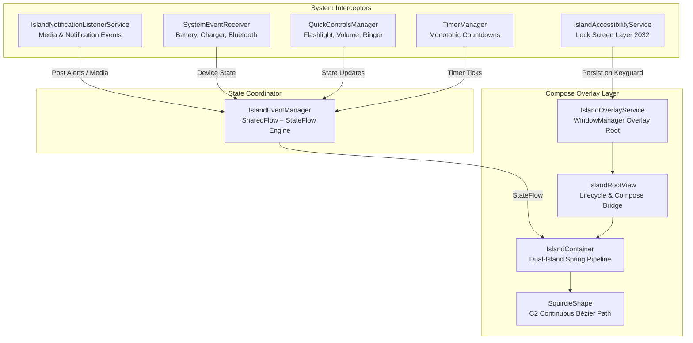

# Dynamic Notch — Nothing Phone (4b) Edition

<div align="center">


<br/>

**A hyper-fluid, physics-driven Dynamic Island overlay engineered natively in modern Jetpack Compose for Android.**  
Specially calibrated for **Nothing Phone (4b)** with **Ndot 57 dot-matrix typography**, authentic **Geist styling**, deep OLED `#000000` aesthetics, and continuous spring mechanics.

[⬇ Download Latest APK (v1.0.0)](https://github.com/ZeroiJ/notch/releases) • [Architecture Guide](docs/THE_NOTCH_ARCHITECTURE.md) • [iOS Island Deep Dive](docs/IPHONE_DYNAMIC_ISLAND_DEEP_DIVE.md)

</div>

---

## ✦ Key Highlights & Nothing OS Aesthetic

* **Nothing OS Design Language:** Built using custom Ndot 57 dot-matrix fonts, Geist variable weighting, and the iconic Nothing glyph red (`#D71921`) accents.
* **Automatic Cutout Auto-Calibration:** Automatically interrogates display hardware cutouts (`DisplayCutout` and `WindowInsetsCompat`) to center precisely on the Nothing Phone (4b) punch hole (X: 540px, safe inset 126px, lens width 32.8dp) with zero manual calibration required.
* **Continuous Bezier Squircle Engine:** True $C^2$ continuous squircle curvature that wraps the hardware lens seamlessly with pure black `#000000` OLED fill, eliminating edge distortion.
* **Non-Linear Spring Dynamics:** Custom damped harmonic oscillators modeled after Apple's iOS CoreAnimation springs with continuous gesture tracking.
* **Lock Screen & AOD Persistence:** Dual-engine overlay using Android's Accessibility overlay layer (`TYPE_ACCESSIBILITY_OVERLAY` = 2032) to persist over the keyguard and system UI.

---

## ✦ Core Features Breakdown

```
+------------------------------------------------------------------------+
|                                                                        |
|                     (  ●  )  DYNAMIC NOTCH                             |
|                                                                        |
+------------------------------------------------------------------------+
|  [1] Hardware Cutout Wrap  |  [2] Lock Screen AOD Persistence          |
|  [3] Live Countdown HUD    |  [4] Quick Controls System Hub            |
|  [5] Inline Reply Engine   |  [6] Multi-Activity Dual Island           |
+------------------------------------------------------------------------+
```

### 1. Hardware Cutout Wrapping & Continuous Squircle
Auto-detects the exact location of the camera sensor at runtime. On the Nothing Phone (4b), it wraps the top-center 126px cutout into an elegant 120dp × 37dp idle pill, morphing outward during alerts.

### 2. Lock Screen & Keyguard Persistence
Unlike standard overlays that vanish when locking the phone, Dynamic Notch leverages `IslandAccessibilityService` (`TYPE_ACCESSIBILITY_OVERLAY`). The island remains visible and interactable across the Lock Screen, Always-On Display (AOD), and full-screen games.

### 3. Live Countdown Timer HUD
Active countdowns run with sub-millisecond precision using monotonic tickers. Features a sleek circular progress indicator, remaining minutes/seconds in dot-matrix typography, and expanded controls (Play / Pause / Dismiss).

### 4. Quick Controls System Toolbar
Swipe down or expand the island to access hardware utilities:
* **Flashlight / Torch:** Direct toggle via `CameraManager`.
* **Ringer Mode:** Cycle between Normal, Vibrate, and Silent via `AudioManager`.
* **Notification Shade:** Pull down the notification drawer effortlessly.
* **Screen Lock:** Global action to immediately lock the device without reaching for the physical power button.

### 5. Inline Messaging Quick-Reply
When notifications arrive from messaging apps (WhatsApp, Telegram, Signal, Messages), Dynamic Notch captures the `RemoteInput` action and presents an inline dot-matrix text field with instant reply submission without leaving your current app.

### 6. Multi-Activity Dual-Island Architecture
When multiple background activities are concurrently active (e.g. Spotify music playback + Kitchen timer), the island splits into two separate floating elements:
* **Primary Island:** Shows album artwork, track title, and animated equalizer.
* **Secondary Detached Bubble:** 37dp floating satellite showing the timer countdown or pending notification glyph.

---

## ✦ Gesture Engine & Physics Specifications

The island uses a 14dp touch slop expansion perimeter (`pillGestureRoom`) so touches around the physical camera hole register effortlessly.

| Mode | Gesture | Target State | Spring Configuration |
| :--- | :--- | :--- | :--- |
| **Idle** | Swipe Down | **Expanded** (330dp × 160dp) | $\zeta = 0.65, k = 650$ (ExpansionMorph) |
| **Expanded** | Swipe Up | **Collapsed** (120dp × 37dp) | $\zeta = 0.70, k = 1200$ (DragTracking) |
| **Any** | Horizontal Swipe Out | **Tucked** (Hidden into edge) | $\zeta = 0.70, k = 300$ (IdleTuck) |
| **Tucked** | Tap Edge | **Restored** | $\zeta = 0.50, k = 850$ (ExpressiveAlert) |
| **Idle** | Single Tap | **Peek / Cycle Activity** | $\zeta = 0.50, k = 850$ (ExpressiveAlert) |

---

## ✦ System Architecture



---

## ✦ Getting Started & Installation

### Option 1: Install Pre-Built APK
1. Download the latest `DynamicNotch-v1.0.0-release.apk` from the **[Releases](https://github.com/ZeroiJ/notch/releases)** page.
2. Install the APK on your Android device (Nothing Phone recommended).
3. Grant required permissions from the onboard setup bench:
   * **Overlay Permission:** `Settings > Display over other apps > Allow`
   * **Notification Access:** `Settings > Notification Access > Allow Dynamic Notch`
   * **Accessibility Service:** `Settings > Accessibility > Installed Apps > Dynamic Notch > Turn On`

### Option 2: Build from Source

```bash
# Clone the repository
git clone https://github.com/ZeroiJ/notch.git
cd notch

# Build release APK with Gradle
./gradlew assembleRelease
```

The compiled APK will be generated at:
```
app/build/outputs/apk/release/app-release.apk
```

---

## ✦ Device Compatibility

* **Primary Target:** Nothing Phone (4b) (`A009P` / `SuperContraIND`)
* **OS Support:** Android 9.0 (API 28) through Android 15 (API 35+)
* **Display Support:** Centered punch hole, pill cutouts, and corner cutouts (auto-calibrated).

---

## ✦ License

This project is licensed under the Apache License 2.0. Built with ❤️ for the Nothing community.
